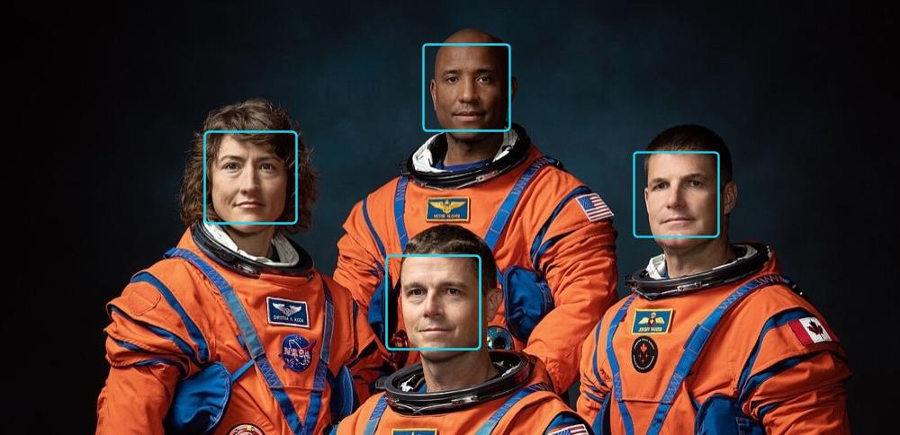
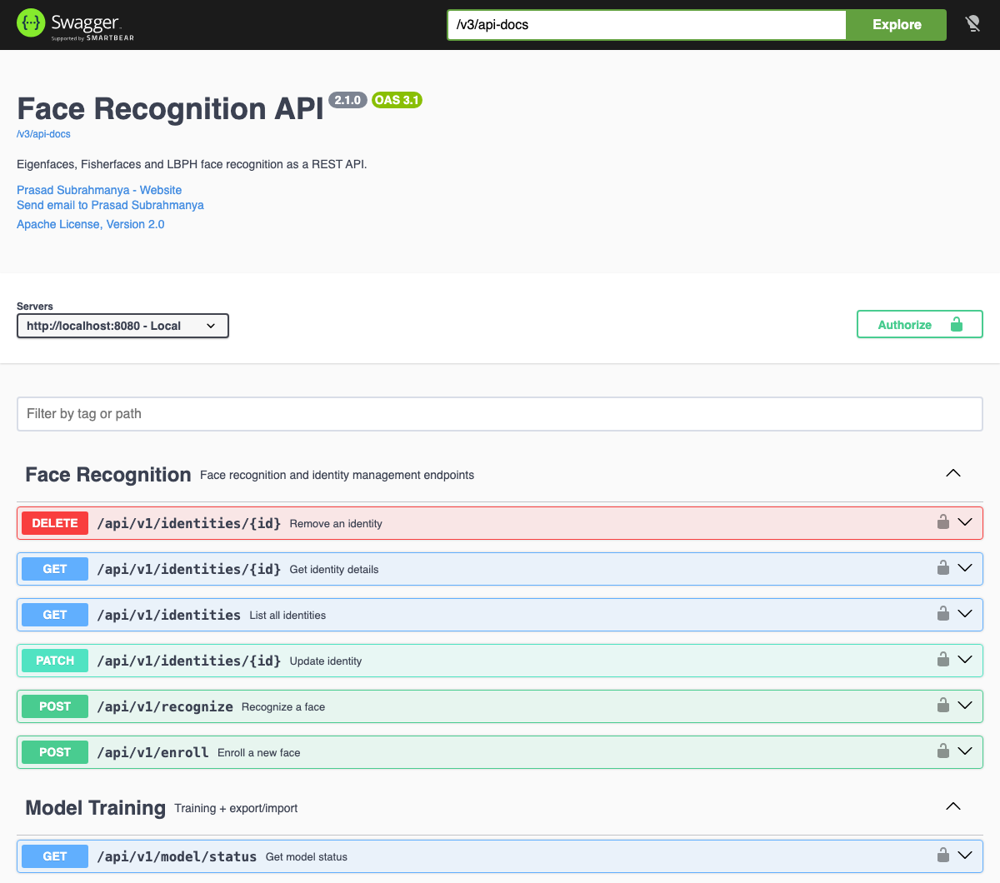
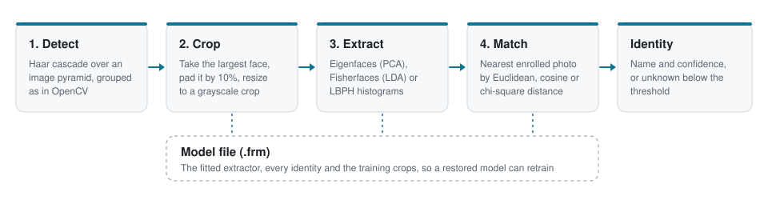

# Face recognition for the JVM

[](https://github.com/prasadus92/face-recognition/actions/workflows/build.yml)


[](License.txt)

Face recognition in plain Java: Eigenfaces, Fisherfaces and LBPH, a Haar face detector that matches OpenCV's `detectMultiScale` on the AT&T/ORL photos, and one jar that runs as a REST API or as a command-line tool. No native libraries, no Python, no GPU.



<sub>`java -jar target/face-recognition-*-exec.jar detect docs/images/artemis-ii-crew.jpg --min-confidence 0.3 --annotate out.jpg` on the Artemis II crew portrait (NASA photo by Josh Valcarcel, public domain).</sub>

## What it does

- **Finds faces** with OpenCV's frontal-face Haar cascade, evaluated in Java over an image pyramid. With OpenCV's default minimum face size of 24 pixels it finds a face in 364 of the 400 AT&T/ORL photos with 366 boxes, as OpenCV 4.14 does, and returns OpenCV's box for the test portrait. The server and CLI use a minimum of 30 pixels, so their boxes can differ by a pixel or 2.
- **Recognizes people** with 3 classical methods behind one `FeatureExtractor` interface: Eigenfaces (PCA), Fisherfaces (LDA) and local binary pattern histograms (LBPH).
- **Rejects most strangers.** Confidence is calibrated on the enrolled photos, so the threshold sits between a typical match and a typical stranger. At the default 0.6, Fisherfaces and LBPH accepted none of 200 stranger photos on ORL, Eigenfaces 10.
- **Runs as a service or a tool.** The same jar serves a REST API with OpenAPI docs, health checks, Prometheus metrics, rate limiting and an optional API key, or runs `train`, `enroll`, `recognize`, `detect` and `benchmark` from the shell.
- **Saves models you can restore.** A model file holds the fitted extractor, every identity and the training crops, so a restarted service recognizes immediately and can retrain. Files are read back behind a deserialization allowlist.

## Accuracy

Measured on the [AT&T Database of Faces](https://www.cl.cam.ac.uk/research/dtg/attarchive/facedatabase.html) (ORL): 400 photos of 40 people. Closed-set rank-1 accuracy, stratified cross-validation, seed 42, 40 components:

| Algorithm | Distance | 10-fold (9 train / 1 test) | 2-fold (5 train / 5 test) |
|---|---|---|---|
| Eigenfaces | Euclidean | 98.25% | 94.00% |
| Fisherfaces | Euclidean | 96.50% | 94.00% |
| LBPH | Euclidean | 98.00% | 92.25% |
| LBPH | Chi-square | **99.00%** | **94.25%** |

With 20 people enrolled and 20 strangers (40 components), the default threshold of 0.6 accepts 10 of 200 stranger photos with Eigenfaces and none with Fisherfaces or LBPH, while matching 73, 68 and 58 of 100 genuine photos. Extracting features from one 48x64 face crop and matching it against 280 photos takes 0.5 ms with Eigenfaces and 6 ms with LBPH on an Apple M1 Pro. Setup, fold deviations, latency and the open-set test are in [docs/benchmarks/orl.md](docs/benchmarks/orl.md). To reproduce every number:

```bash
scripts/benchmark-orl.sh
```

ORL is small, frontal and well lit. These methods are a clear, inspectable baseline; for photos taken in the wild, modern embedding networks do far better (see the [roadmap](ROADMAP.md)).

## Quickstart

With Docker:

```bash
docker build -t face-recognition .
docker run --rm -p 8080:8080 -v face-data:/app/data face-recognition
```

From source, with JDK 25 (the Maven Wrapper fetches Maven):

```bash
./mvnw -DskipTests package
java -jar target/face-recognition-*-exec.jar
```

Then open <http://localhost:8080/swagger-ui.html>. The model is saved to `data/models/default.frm` (the `face-data` volume in Docker) after every training run and loaded again at startup.

## REST API

Enroll a few photos per person, train, then recognize:

```bash
curl -F image=@ann-1.jpg -F name="Ann" http://localhost:8080/api/v1/enroll
curl -F image=@ann-2.jpg -F name="Ann" http://localhost:8080/api/v1/enroll
curl -X POST http://localhost:8080/api/v1/train
curl -F image=@probe.jpg -F maxAlternatives=1 http://localhost:8080/api/v1/recognize
```

A recognition response for an ORL photo against a gallery of 3 people, trimmed to the main fields:

```json
{
  "status": "RECOGNIZED",
  "recognized": true,
  "bestMatch": { "name": "Person 2", "confidence": 0.9996, "distance": 0.265 },
  "alternatives": [ { "name": "Person 1", "confidence": 0.0426, "distance": 1.293 } ],
  "metrics": { "detectionTimeMs": 11, "extractionTimeMs": 1, "matchingTimeMs": 2, "totalTimeMs": 14 }
}
```

`threshold` (0 to 1) and `maxAlternatives` override the configured values per request. Statuses are `RECOGNIZED`, `UNKNOWN` (nobody passed the threshold) and `NO_FACE_DETECTED`.

| Endpoint | Purpose |
|---|---|
| `POST /api/v1/enroll` | Add a photo of a person (multipart `image`, `name`, optional `externalId`) |
| `POST /api/v1/train` | Fit the extractor on every enrolled photo |
| `POST /api/v1/recognize` | Identify the largest face in a photo |
| `GET /api/v1/identities`, `GET`, `PATCH`, `DELETE /api/v1/identities/{id}` | List, read, rename or soft-delete people |
| `GET /api/v1/model/status` | Algorithm, people, photos, readiness |
| `POST /api/v1/model/export`, `POST /api/v1/model/import` | Download or upload a model file |
| `GET /actuator/health`, `/actuator/prometheus` | Liveness, readiness, model state and metrics |



Errors share one JSON shape with a `traceId` that matches the `X-Request-ID` header and every log line of the request. Requests are rate limited per client IP (60 per minute by default; `X-Forwarded-For` counts only from proxies on private addresses), uploads are capped at 10 MB, and setting `facerecognition.security.api-key` requires an `X-API-Key` header.

## Command line

Run the jar with a command instead of starting the server. Photos are treated as face crops unless you add `--detect`; use the same setting for every command on a model.

```console
$ java -jar target/face-recognition-*-exec.jar train faces/ -o people.frm
Trained Eigenfaces on 15 images of 3 people in 496 ms. Model: people.frm

$ java -jar target/face-recognition-*-exec.jar recognize -m people.frm probes/
probes/person-1.png	person-1	0.979
probes/person-2.png	person-2	0.998
probes/person-3.png	person-3	0.985

$ java -jar target/face-recognition-*-exec.jar enroll -m people.frm -n "person-4" new/*.png
Enrolled 3 images of person-4. The model now knows 4 people.

$ java -jar target/face-recognition-*-exec.jar detect portrait.png
portrait.png	95,88,116,116	1.00
```

`train` expects one folder per person (`faces/<name>/<photo>`) and reads JPEG, PNG, BMP, GIF and PGM. `recognize` and `detect` take files or folders and can print `--json`. The last column of `detect` is a face's support relative to the best face in the same image. `benchmark DATASET --format orl` runs the accuracy harness. Each command has `--help`.

A gallery of 3 people gives the confidence calibration little to learn from, so expect some strangers to pass at the default threshold; the open-set numbers above use 20.

## How it works



1. **Detect.** The image is converted to grayscale and resized into a pyramid. At each level the 24x24 Haar cascade slides across it; each weak classifier compares a weighted sum of rectangles, read from an integral image, with its threshold scaled by the window's standard deviation. Overlapping hits are grouped as `cv::groupRectangles` does.
2. **Crop.** The largest face box grows by 10% on each side, is cropped, resized to a 100x100 grayscale image and histogram-equalized. Without a detector (the CLI default) the whole image is the crop.
3. **Extract.**
   - Eigenfaces projects the crop onto the principal components of the training set (Turk and Pentland, 1991).
   - Fisherfaces applies PCA, then the linear discriminant that best separates the enrolled people (Belhumeur, Hespanha and Kriegman, 1997).
   - LBPH splits the crop into an 8x8 grid and concatenates a histogram of local binary patterns per cell (Ahonen, Hadid and Pietikainen, 2006).
4. **Match.** The probe goes to the person with the nearest enrolled photo. Confidence is a logistic curve calibrated on the gallery. A probe as close as a typical photo of the same person scores about 0.98; one as far as the typical nearest other person scores about 0.02.

## Configuration

The server reads [`application.yml`](src/main/resources/application.yml), and environment variables such as `FACERECOGNITION_EXTRACTION_ALGORITHM=LBPH` override it. The CLI uses its own flags and these defaults.

```yaml
facerecognition:
  detection:
    type: HAAR_CASCADE          # HAAR_CASCADE | SKIN_COLOR
    min-face-size: 30
  extraction:
    algorithm: EIGENFACES       # EIGENFACES | FISHERFACES | LBPH
    num-components: 10
  classification:
    distance-metric: EUCLIDEAN  # EUCLIDEAN | COSINE | MANHATTAN | CHI_SQUARE
  recognition:
    threshold: 0.6
  model:
    save-path: data/models/default.frm
```

## Use as a library

The library is not on Maven Central yet. Run `./mvnw install`, then depend on `com.facerecognition:face-recognition:2.1.0-SNAPSHOT`.

```java
FaceRecognitionService service = FaceRecognitionService.builder()
        .detector(new HaarCascadeFaceDetector())
        .extractor(new EigenfacesExtractor(40))
        .classifier(new KNNClassifier())
        .build();

service.enrollFromFile(new File("ann-1.jpg"), "Ann");
service.enrollFromFile(new File("ann-2.jpg"), "Ann");
service.enrollFromFile(new File("bo-1.jpg"), "Bo");
service.enrollFromFile(new File("bo-2.jpg"), "Bo");
service.train();

service.recognizeFromFile(new File("probe.jpg")).getBestMatch()
        .ifPresent(match -> System.out.printf("%s (%.2f)%n",
                match.getIdentity().getName(), match.getConfidence()));

Files.write(Path.of("people.frm"), service.exportModel());
```

## Project layout

```text
src/main/java/com/facerecognition/
  domain/          FaceImage, Identity, FeatureVector and the detector, extractor and classifier interfaces
  application/     FaceRecognitionService: enrollment, training, recognition, model export and import
  infrastructure/  Haar detector, Eigenfaces, Fisherfaces, LBPH, nearest-neighbor classifier, model files
  config/          the factory and Spring auto-configuration that build the pipeline from application.yml
  api/rest/        controllers, DTOs, filters, health and metrics
  api/cli/         picocli commands
  benchmark/       accuracy, cross-validation and latency harness
```

## Development

```bash
./mvnw -Pci verify
```

That runs the unit and integration tests, Checkstyle, SpotBugs and the JaCoCo coverage floor, which is what CI runs on every pull request alongside CodeQL and a Docker build that starts the container and checks its health. See [CONTRIBUTING.md](CONTRIBUTING.md), and [CLAUDE.md](CLAUDE.md) for coding agents.

## Credits

- The face database is courtesy of AT&T Laboratories Cambridge.
- The Haar cascade is OpenCV's `haarcascade_frontalface_default.xml` (BSD license; see [NOTICE](NOTICE)).
- The Artemis II crew photo (NASA, Josh Valcarcel) and the test portrait (NASA photo S85-41895) are in the public domain; sources are in [NOTICE](NOTICE). Their use implies no NASA endorsement.
- Built on Spring Boot, picocli, JAMA, Micrometer, Bucket4j and springdoc-openapi.

## License

[Apache License 2.0](License.txt). Written by [Prasad Subrahmanya](https://github.com/prasadus92).
